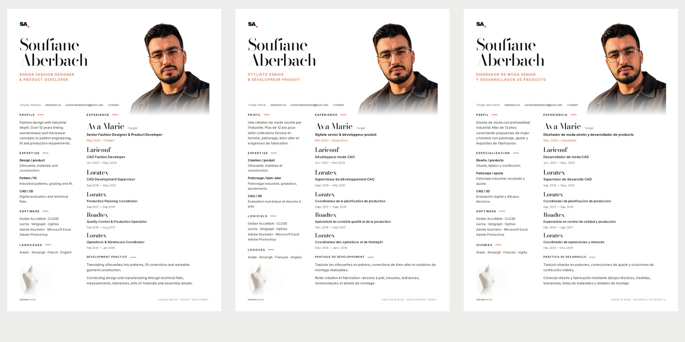

# ABERBACH — Fashion Editorial creative reset

**Unpublished review editions, not released website CVs.** Continues draft PR #59
on `feat/cv-editorial-rebuild`, based on multilingual PR #58. The owner rejected
the preceding composition; it is superseded, not cosmetically restyled.

## Visual concepts before production

Two complete photographic A4 studies were generated from the real owner portrait
and the site's SA. reference before the production template was edited.
Generated study text is placeholder composition material, **not career evidence**;
incorrect study dates/titles/software were never copied into the production data.

[Concept 01 — Fashion Editorial Luxury](Concept-01-Fashion-Editorial-Luxury.png)
uses a serif identity, upper-right portrait blending into white, an open experience
column and a lower-left atelier atmosphere. **Selected:** it gives photography,
identity and reading hierarchy a coherent relationship without a timeline spine.

[Concept 02 — Modern Fashion Studio](Concept-02-Modern-Fashion-Studio.png)
uses a left photographic studio band, a right sans-serif identity and opposing
experience/expertise columns. An initial generation introduced skill bars and a
timeline; it was rejected and regenerated. The corrected study remains less
distinctive than 01 and its giant SA/name treatment competes with the profession.

The selected concept was reconstructed with editable typesetting, not flattened
model text. The name is smaller than the generated study, the original six-role
chronology replaces its fictitious sample content, and the dress form is reduced
to a quiet lower-margin photograph clear of all text. The former outlined surname,
administrative date rail, collar drawing and verification footer are removed.

## Portrait, atmosphere and authentic identity

`scripts/cv/portrait.jpg` remains the exact owner-supplied 1166×1280 color JPEG.
An image-tool background-removal edit provides an **alpha mask only**. The final
layout displays the original JPEG through that mask: none of the tool's edited
facial RGB pixels is used. Skin, eyes, expression, hairline, glasses, age and
clothing therefore come from the actual source. Only the background/outer edge
is masked, with a soft lower fade integrating the shoulder into the page.
Source and mask hashes are retained in `portrait-source.json` and each layout
report. All three rendered portrait windows are pixel-identical to one another.

The dress form is an image-generated photographic atmospheric asset, explicitly
authorized by the brief. It does not claim to depict the owner's actual atelier
or any employer/client. Its origin/hash are recorded in `atmosphere-source.json`.
It is placed below the longest language column, never over CV information.
No technical diagram, collar or invented pattern graphic remains in production.

The SA. uses the real `SiteHeader.astro` span/orange-dot markup, original Archivo
font and `.brand`/`.brand i` CSS read verbatim from `src/styles/global.css`.
Its measured36.15625 × 31.1875 CSS px dimensions match the site. Signature orange
#D45F36 connects the professional title, current-role date and section headings.
Openly licensed Bodoni Moda supplies the editorial serif; Archivo and Inter retain
the site's identity/readability. The OFL license is included with the font.

## Content: facts retained, unsupported duties removed

LinkedIn was rechecked on30 October 2026 and returned HTTP 999. No LinkedIn PDF is
attached. The full About, role titles/dates/descriptions, education qualifications,
certifications and skills cannot be cross-checked against the complete profile.
The public index's fragments and other people's posts are not career evidence.

The six companies, exact English titles and dates match the owner's explicit
career-history briefs and the current Experience page. The latest instruction
allows conservative factual content where exact descriptions are unavailable.
The review editions retain these facts but publish **zero employer-duty claims**.
The rejected empty job-function paraphrases have been removed. A concise profile
and career-wide development-practice text explain the connection between design,
construction and manufacturing without inventing what happened at an employer.

Eight software tools and Arabic/Amazigh/French/English come from owner-confirmed
information. Spanish is an edition only. No proficiency levels, degrees,
certifications, named brand contracts, metrics or management scale are invented.
Education and brand exposure are omitted. French and Spanish use professional
terms such as bien-aller/gradation/nomenclatures and ajuste/escalado de tallas/
listas de materiales without upgrading historical seniority.

## Actual critique and refinement

The complete EN/FR/ES pages were inspected individually at 2480 × 3508. The flowing
portrait and light serif name establish a fashion-editorial identity; Ava Marie
remains the strongest experience entry. The photographs have distinct roles:
person first, atelier atmosphere second. The layout remains a usable CV.

Visible issues corrected during review:

- Removed an edition label that crowded the portrait hairline.
- Reduced the name from 65 to 60 CSS px, without retaining an outlined surname.
- Moved and cropped the atelier photograph to clear the longer French text.
- Increased supporting text sizes and edited profile/skill wording rather than
  globally compressing typography to fit.
- Kept software names intact on deliberately composed lines; Microsoft Excel
  no longer breaks into an isolated final word.
- Balanced development-practice line endings; removed all draft notices from
  the actual page artwork. Proof status stays in filenames/metadata/reporting.

Body copy is approximately 9 pt at A4; dates/contact are smaller supporting
metadata. All languages retain white printer-safe margins, clear accents,
complete chronology, no overlap and a common portrait composition. The subdued
dress form is a recognizable photograph, not a technical-symbol substitute.

## Images first, then matching PDFs

The three PNGs were rendered and visually reviewed before PDF conversion. Each
PDF embeds that exact PNG on a 210 × 297 mm page, with tagged source text and links
retained beneath. Redundant hidden source photographs are removed. Verification
checks the embedded raster's decoded pixels against its PNG, single-page A4
dimensions, full selectable text, contact links, all titles/tools/languages and
the six-role chronology. No PDF/UA certification is claimed.

| Edition | Native 2480 × 3508 PNG | Matching searchable A4 PDF |
| --- | --- | --- |
| EN | [English image](editions/Soufiane-Aberbach-CV-EN.png) | [English PDF](editions/Soufiane-Aberbach-CV-EN.pdf) |
| FR | [French image](editions/Soufiane-Aberbach-CV-FR.png) | [French PDF](editions/Soufiane-Aberbach-CV-FR.pdf) |
| ES | [Spanish image](editions/Soufiane-Aberbach-CV-ES.png) | [Spanish PDF](editions/Soufiane-Aberbach-CV-ES.pdf) |

## Release status and automatic-review blocker

Automatic approval review **rejected writing replacement files to public/cv**
because complete LinkedIn verification is still unavailable, citing the owner's
earlier prohibition on finalizing unverified professional information. This was
not bypassed. The renderer retains a source-verification gate. Proof mode and
proof PDF conversion are restricted to directories outside public/ and metadata
explicitly identifies the PDFs as unpublished design proofs.

All six review downloads were served locally and checked for HTTP 200, correct
PNG/PDF MIME types and exact bytes. They are accessible here for owner review,
but are not the website's replacement files. Existing six public assets, download
controls and every Portfolio/Contact/TechPack/Cloudflare source remain unchanged.
No merge or production deployment was performed.

Remaining release action: obtain the LinkedIn PDF for complete verification, or
explicit owner authorization to release the shown editions using only the
documented owner/site facts while omitting unavailable duties and education.
The requested reviewable design and six matching review artifacts are ready.

Machine results and source fingerprints are in [verification.json](verification.json).
