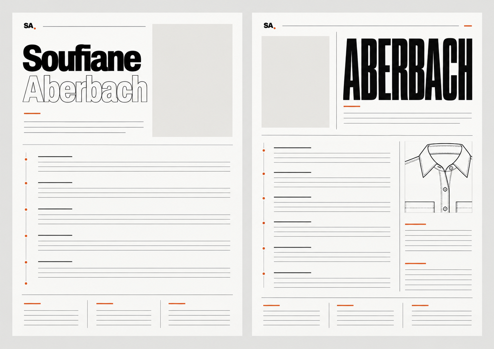
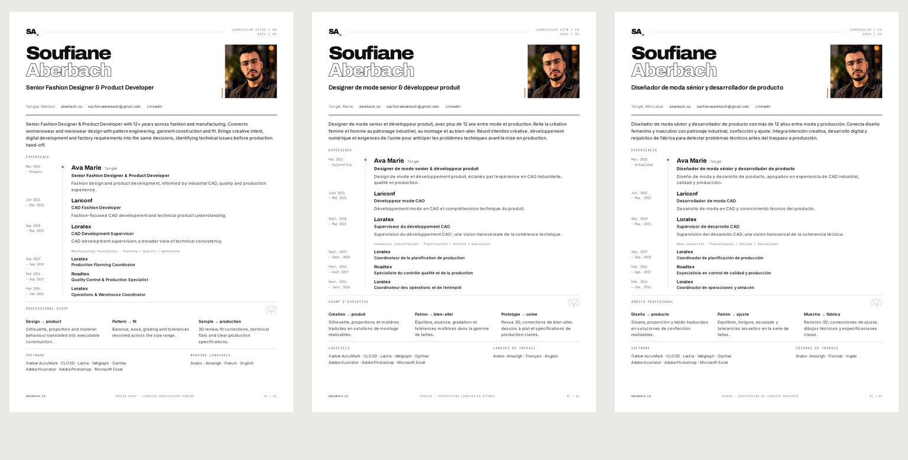

# Editorial Precision — visual conception and source audit

Continuation of PR #59 on `feat/cv-editorial-rebuild`, after rejected 9f44ffc.
Parent remains the multilingual PR #58. No website, backend, photograph collection,
garment data, Tech Pack or Cloudflare configuration is changed.

## Visual conception before typesetting

The live website and its source were inspected: the actual SA. span/dot logo,
Archivo filled/outlined name contrast, JetBrains Mono orientation labels,
restrained orange, neutral ink and photographic hierarchy. A real local render
with committed font fixtures verified the logo construction.

Image generation then produced two distinct A4 composition studies. These are
art-direction studies only; no generated name or letterform is used in final
production typography. No invented person was generated.

**A — Fashion Editorial, selected.** Filled/outlined identity, upper-right image,
a date rail and open full-width chronology; supporting expertise forms an edited
lower-page system rather than another generic sidebar. This is closest to the
site and gives the substantive experience a continuous reading path.

**B — Technical Luxury, rejected.** Its severely condensed oversized surname and
larger garment drawing compete with the professional narrative and drift toward
poster typography. Its strongest ideas did not justify mixing two designs.

Concept A was reconstructed as editable type in `scripts/cv/template.html`. The
header was reduced for real résumé reading space, the role title set as a single
line, and repetitive early-career captions replaced with one clearly labeled
manufacturing-foundation line. The same art direction applies to all editions.

## Authentic identity and technical signature

The real site's `.brand` and `.brand i` CSS are read verbatim, not approximated.
The same Archivo font, 900 weight, −.08em tracking, 1.3rem type and .38rem orange circle
are used. After two animation frames of font settling, the mark matches the site
at 36.15625×31.1875 CSSpx (root 16px). Earlier font-timing measurement differed and
was corrected rather than relaxing the identity check.

One small collar/placket crop comes directly from the current AB-W-SH-01 flat.
Source SHA256, crop pixels and exact pixel equality are checked. It sits quietly
at the professional-scope grid, away from the SA. identity. No generated pattern,
fictional grading system, decorative ruler or new technical drawing is used.

## Professional content and LinkedIn verification

The owner has designated [LinkedIn](https://www.linkedin.com/in/soufiane-aberbach-6799b7155)
as the primary professional source. Direct access returned HTTP 999, confirmed
again on 2026-10-30 after the owner's latest instruction. A search
reader exposed an indexed public version, but its About is truncated and most
professional fields are hidden. Reactions and posts by other people are excluded.

| Section | Accessible | Not verified |
| --- | --- | --- |
| About | Opening fragment only | Complete professional summary |
| Experience | Ava Marie name/location and incomplete entries | Role titles, exact dates, descriptions and responsibilities |
| Education | Partial institution/year fragments | Qualifications, disciplines, completion and complete chronology |
| Certifications | No complete section exposed | Whether certifications exist and their details |
| Skills | Complete list not exposed | Skill entries and qualifications |

No complete-profile verification is claimed. The current six-role site record
is retained provisionally, with no inferred correction or added diploma.
Speculative duty bullets from9f44ffc were removed. Current proof text uses
conservative job-function context; technical value is described as career-wide
scope instead of falsely assigning deliverables to employers.

All current master editions consistently say12+ years, based on the supplied
February 2014start. Photoshop, Microsoft Excel and Amazigh are owner-confirmed;
Spanish remains a publication language only. Brand exposure is omitted because
verified responsibilities matter more than ambiguous brand associations.

**Required to finalize:** the owner’s LinkedIn-exported PDF, or screenshots of
full About, Experience, Education, Certifications and Skills. Final rendering and
PDF production reject the pending career-verification state.

## Portrait status

The new 2026-10-30 attachment has now been recovered and inspected. The actual
1166×1280 RGB photograph is stored as `scripts/cv/portrait.jpg`, outside public/.
Its bytes match the supplied JPEG exactly; `portrait-source.json` records the
SHA256. The obsolete grayscale source has been removed. No generative retouch,
recoloring, reshaping, age change or synthetic facial detail was applied. The
original photograph already provides warm natural light and a clear expression.

The portrait is integrated with the selected editorial window using CSS
`object-fit:cover; object-position:50% 34%`. This only frames the original image;
it does not change its pixels or facial structure. The full hairline, glasses,
eyes and chin remain visible. All three rendered portrait windows are identical,
and independent checks require actual color in both source and rendered image.
Proof footers now identify the sole pending input: full LinkedIn verification.
No placeholders or unverified replacement exports have been copied to public/.

## Actual visual critique and refinement

The complete EN/FR/ES typeset proofs were rendered at 2480×3508 and visually
inspected at native resolution. The filled/outlined name and authentic SA. are
recognizably part of the website. The chronology remains the main document,
with current Ava Marie role strongest. Date ranges were corrected to two lines;
shorter expertise headings prevent neighboring French headings crowding each
other. Font-settling waits ensure measurements describe actual Archivo glyphs.

The first reconstruction left insufficient lower-page clearance. Header spacing,
portrait frame and title composition were edited; redundant career captions were
removed. Type was not globally shrunk. The motif was moved out of the masthead
to avoid reading as a second pasted logo. Final proof checks show no clipping,
correct accents, matching brand geometry and white printer-safe margins.

The technical source crop remains proportional and unmodified. On 2026-10-30,
all three complete proofs were inspected again at native resolution with the
actual color photograph. The warm portrait supplies a controlled color presence;
its size supports the name and professional title rather than competing with
the chronology. Facial features remain intact inside the crop. EN/FR/ES headings,
accented characters, margins, footer and date rail remain clear, with no overlap.
Content remains subject to full-profile verification, not visual approval alone.

## Proofs and verification

These are **concept proofs, not final CVs**:
[EN A4](proofs/Concept-A-EN-proof.png) ·
[FR A4](proofs/Concept-A-FR-proof.png) ·
[ES A4](proofs/Concept-A-ES-proof.png).

Independent checks cover 2480×3508, 300 DPI, white margins, six provisional roles,
three edition keys, four spoken languages, eight tools, logo proportions,
construction-source pixels, portrait-frame consistency and overflow. Actual
source access and layout metrics are recorded in [verification.json](verification.json).
Composition, source integrity and natural-color portrait integration have been
checked. Final career verification and release PNG/PDF fidelity remain blocked
by the missing LinkedIn export. Existing public download paths and site controls
are unchanged. The proof content is provisional, not an approved professional CV.

On 2026-10-30, the site build passed with 36 pages and the localization suite
passed 691 checks with zero failures using the pinned browser. The independent
three-edition proof checks passed. Expected refusals of unverified release,
public preview output and preview-to-final PDF conversion were also exercised.
No final CV release test or new PDF accessibility approval is claimed while the
primary source remains inaccessible. `public/`, `src/`, `worker/` and Cloudflare
configuration have no changes relative to the preceding creative checkpoint.
