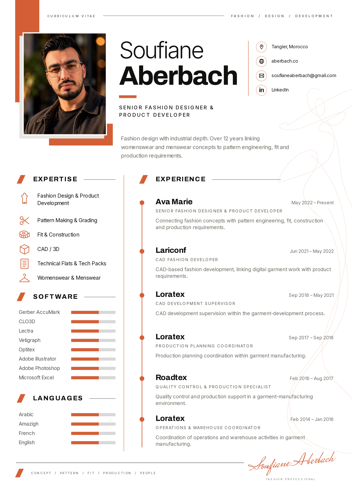

# Corrected English adaptation — locked owner master

**Owner visual review pending. English only. No merge, deployment, public
replacement or French/Spanish generation.** The preceding adaptation was
rejected; this package restores the visual elements the owner explicitly locked.

[Full-size A4 PNG](Soufiane-Aberbach-CV-EN.png) ·
[Matching A4 PDF](Soufiane-Aberbach-CV-EN.pdf) ·
[Self-contained HTML/CSS](Soufiane-Aberbach-CV-EN.html) ·
[Master / adaptation comparison](Master-and-English-comparison.jpg)

## Adaptation, not a new concept

The supplied model's 905 × 1280 coordinate system controls composition. Its
portrait position, broad orange banner/lower base, white/light-grey framing,
name hierarchy, masthead, upper-right contact rail and circular icon system
have been reconstructed. The left column again contains six subject-matched
expertise pictograms, eight software bars and four language bars. Section
slashes, thin rules, aligned dates, six orange timeline nodes, the cropped
fashion gesture and script-name footer restore the model's visual system.

The portrait and canonical professional content replace the reference content.
Minor name-width/sidebar/footer adjustments were made after a side-by-side
render comparison. The original photographer's color JPEG is unchanged, as
confirmed by its SHA-256 hash; only a sharp cover crop is used. No neon asset,
photo mannequin, portrait generation, blur, filter, masking or haze is involved.

The new fashion SVG follows the locked model's edge placement and flowing
silhouette. It uses thin unfilled orange curves at 12% opacity. It remains a
background gesture, behind the reading layer.

## Accuracy

LinkedIn's complete profile remains inaccessible (previous HTTP 999); no
complete-profile verification is claimed. The owner-authorized canonical
fallback supplies all identity, exact dates/titles, summary, expertise, tools
and spoken languages. Supporting text is deliberately limited to title-derived
context and the owner's professional positioning. It adds no projects, metrics,
team supervision claims or unsupported detailed employer task lists. Education
and certifications remain omitted. Spanish is not listed as a spoken language.

The model's bars are restored as **identical decorative motifs**, hidden from
accessibility APIs, with no proficiency values or differing levels. The footer
uses a licensed script typeface to restore the model's feeling; it is a typeset
name, not a reproduced or asserted handwritten autograph.

## Actual QA

- Full-page native-resolution PNG viewed and compared with the locked model.
- Name width, sidebar headings and footer alignment refined after comparison.
- All six roles/dates, eight tools, six expertise areas and four languages checked.
- Crisp original RGB portrait and no filter/mask/blur confirmed.
- 2480 × 3508 pixels; 300 DPI; white background; loaded embedded fonts.
- No text clipping or contact/software overflow. Text remains within safe margins.
- One-page 210 × 297 mm PDF. Its decoded visible raster is pixel-identical to PNG.
- Searchable/selectable text and three live contact links. Letter tracking is
  removed only from the hidden PDF search layer to prevent false intra-word spaces.
- PNG/PDF downloads locally served as HTTP 200 with correct MIME types/exact bytes.
- English CV proof check passed. Build passed: 36 pages. Localization: 691/691.
- 108 protected original source fingerprints retained. Public assets, website
  source, backend and Cloudflare configuration unchanged from the previous checkpoint.
- FR/ES rendering and release replacement refuse while owner review is pending.

The master intentionally has a top-edge orange accent and cropped right-edge
line art. Exact edge reproduction needs borderless printing; all readable text
is kept inside the printable area. No PDF/UA conformance certification is claimed.

[Detailed receipts](verification.json) · [Layout measurements](layout-report.json) ·
[PNG inspection receipt](image-review.json) · [Download checks](download-checks.json)
