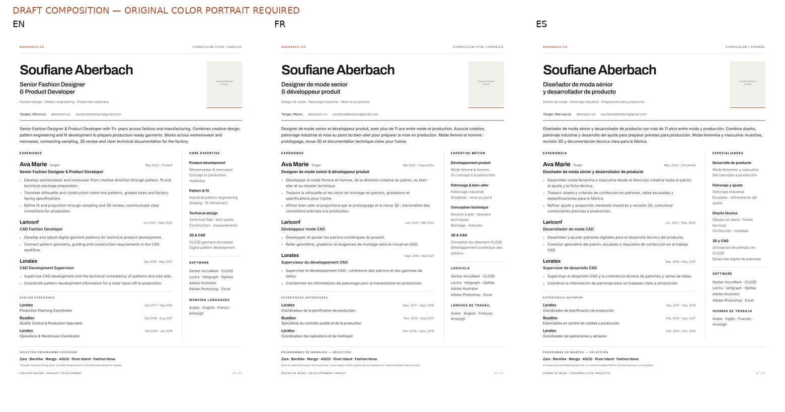

# CV editorial rebuild — work in progress

> Superseded creative direction. Current concept studies and source audit: [Editorial Precision](../cv-final-2026-10-29/REVIEW.md).

Base: `37180aec58636b4373e0823fa4cc285a43688d12` from unmerged PR #58.
Current main was rechecked and remains `6a48781`. This branch depends on the
existing EN/FR/ES implementation; the proposed diff concerns the CV system only.
No merge or production deployment is authorized or attempted.

## Design and content changes

The old design devoted too much space to an oversized stacked name, then offered
six mostly bare job titles. The new composition uses a single-line mixed-case
identity, a smaller natural-color portrait frame and a compact senior title.
A wider experience column leads the page; a narrow side column carries grouped
expertise, tools and actual working languages. Earlier roles are concise but
retain the complete chronology. Orange is limited to small rules and bullets.
The white print background and existing Archivo/Inter identity are retained.

The summary now explains the connection between creative design, pattern
engineering, fit and production readiness. Current-role/CAD bullet drafts describe
patterns, graded size sets, sampling/3D review, technical packages and production
hand-off. They are functional interpretations of owner-confirmed specialties,
not independent proof of detailed employer assignments. Exact attribution is
pending the clarification requested during this task. No quantities, team sizes,
sales results, awards, certifications or education are invented.

Photoshop, Excel and Amazigh are included from the new owner brief. Exactly three
publication languages remain EN/FR/ES; Spanish is not added as a spoken language.
Selected Zara/Bershka/Mango/ASOS/River Island/Fashion Nova exposure is sourced from
Home and qualified as manufacturing-programme exposure, never direct employment
or brand endorsement.

## Actual render critique and refinement

The first coherent page was rendered in Chromium at 2480×3508 using the committed
fonts. Its repeated practice section pushed content into the footer. That
redundancy was removed rather than reducing type. The next pass added stronger
responsibility-style bullets; concise French composition, smaller header spacing
and deliberate software grouping recovered the required space. All six career
positions remain visible and the three major roles now have substantive copy.

Native EN/FR/ES renders were visually inspected: clean chronology, aligned dates,
readable technical terms, correct accents, clear current-role emphasis and no
clipped paragraphs. Software/languages remain subordinate. Brand names have a
separate explanatory qualifier. The broad left column keeps experience prose
readable; no charts, progress bars, decorative icons or boxed skill widgets.

The final draft preview uses a neutral COLOR PORTRAIT PENDING frame. Earlier
internal layout tests temporarily used the existing gray source; that was not
an approved portrait treatment and is not a final output.

## Essential remaining input

Only the grayscale derivative survived from the previous CV production. The
original color attachment is missing from the workspace. The owner has been
asked to reattach it. Natural colors cannot be recovered accurately from the
monochrome file. Final exports deliberately stop until the actual color photo
is available; no synthetic colorization or face replacement is used.

The release renderer tests actual color pixels. Preview mode cannot write to
public/, and final PDF conversion rejects preview masters. The prior six public
files remain unchanged, preventing incomplete new assets from being served.

## Verification

- `node --check scripts/cv/render.mjs`: passed.
- EN/FR/ES native A4 draft rendering and independent layout checks: passed.
- White printer-safe borders, DPI, identical frame position and no clipping:
  verified in all three composition previews.
- Website build: passed, 36 pages. `npm run test:i18n`: 691 passed, 0 failed, including actual language-matched PDF/PNG downloads at the existing paths. No website, Worker, Contact, Tech Pack or Portfolio source is modified.
- Export guards: expected rejection of monochrome release input, public-path draft rendering and draft-to-final PDF conversion all verified.
- Final natural-color PNG/PDF verification is **pending the original photo**.

Production instructions: [scripts/cv/README.md](../../scripts/cv/README.md).
