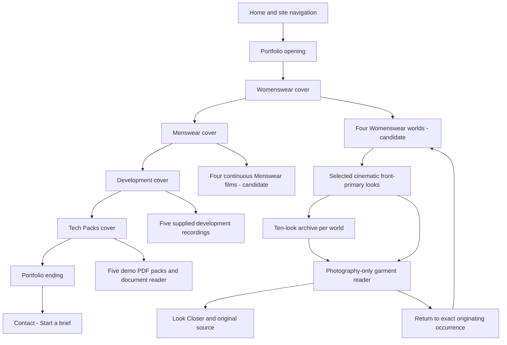

# Site map and navigation

**ACTIVE · page map originally verified 19 October; Menswear source updated 21 October 2026. Earlier page verification baseline: main
`a36ae62af385641f2c4d92c07bcd851d10ee24d7`.**
Menswear implementation baseline: `a4b0aba1591ac043b11ca9b75b6079b0ed27a9be`.
Public GET results are [separate dated evidence](PUBLIC-OBSERVATIONS-2026-10-19.md).
Astro is a static build; fragments are client-side states, not separate pages.

## Public pages

The shared [route manifest](../../src/data/site-routes.mjs) supplies the XML
sitemap, domain tests and diagnostics. Header/footer links come from
[SiteHeader](../../src/components/SiteHeader.astro) and
[SiteFooter](../../src/components/SiteFooter.astro).

| URL path | Page | Navigation / indexing |
| --- | --- | --- |
| `/` | Home | Header/footer; indexable. |
| `/expertise/` | Expertise | Header/footer; indexable. Four temporary supplied visual plates. |
| `/portfolio/` | Portfolio | Header/footer; indexable. Four internal chapters, not four page routes. |
| `/process/` | Process | Header/footer; indexable. Decision stages; three neutral holding-image slots. |
| `/experience/` | Experience | Header/footer; indexable. Professional background; not a verified garment catalog. |
| `/contact/` | Contact | Header/footer and Start a brief; indexable. Form plus direct email path. |
| `/privacy/` | Privacy & Confidentiality | Footer trust navigation; indexable. |
| `/before-we-start/` | Before We Start | Footer trust navigation; indexable. |
| `/working-terms/` | Working Terms | Footer trust navigation; indexable. |
| `/contact/sent/` | Brief received | Flow endpoint, `noindex, follow`, excluded from XML sitemap; visiting it is not evidence a brief was received. |
| `/404.html` | Generated error document | From `404.astro`; noindex, excluded from sitemap. Host decides missing-path handling. |
| `/robots.txt` | Wildcard allow policy and sitemap link | Generated endpoint, not a navigable editorial page. |
| `/sitemap.xml` | Nine indexable page URLs | Generated from the route manifest; no fragments, labs, success/error pages. |

No `/menswear/`, `/womenswear/`, `/pattern-development/`, `/tech-packs/`, locale
routes or individual project pages exist as public Astro routes. Do not invent
them in navigation or SEO descriptions. Future standalone project URLs require a
separate SEO/data/routing task.

## Portfolio internal structure

The internal four-world / continuous-film nodes describe the pending corrective
candidate; main retains the older structure until merge. Cover arrows describe the outer editorial order. Chapter contents open as
layers with their own scroll containers; visitors are not forced through every
internal item before reaching the next cover. The opening resolves directly into
the Womenswear cover. No intermediate large index/splash is present.

| Visible destination | Actual Portfolio fragment / behavior |
| --- | --- |
| Opening / index | `#portfolio-index` is a native anchor; enhanced data-nav return normalizes it to the base Portfolio URL. |
| Chapter covers | `#cover-womenswear`, `#cover-menswear`, `#cover-3d-simulation`, `#cover-tech-packs`; compact running chapter control links here. |
| Womenswear | `#womenswear`; opens the act, category toggle and photographic territories. |
| Womenswear category | `#womenswear/casualwear`, `#womenswear/activewear`, `#womenswear/evening`, `#womenswear/swimwear` in the corrective candidate. Legacy `rtw` and `streetwear` aliases both arrive in Casualwear; main still has five worlds until merge. |
| Womenswear reference | `#womenswear/<category-id>/<reference-id>`, e.g. `#womenswear/rtw/rtw-ref-01`. All 58 resolve, including excluded historical looks. |
| Menswear | `#menswear`; first film, with direct four-world navigation. Implemented in main PR #44. |
| Menswear category | `#menswear/m-streetwear`, `#menswear/m-activewear`, `#menswear/m-rtw`, `#menswear/m-tailoring`. Candidate: one native four-world scroll flow, direct world/scene/archive controls, Presentation Mode and photographic readers. Main retains manual film activation until merge. Scene positions are UI state, not a second hash router. |
| Menswear reference | `#menswear/<category>/<reference-id>`; forty displayed looks, fifty routable historical/current identities. Example: `#menswear/m-streetwear/m-streetwear-pexels-6311316`. Router history and actual source-occurrence return remain authoritative. |
| Pattern Development | `#3d-simulation`; cover/navigation title Development, internal heading Pattern Development. Keep legacy ID. |
| Tech Packs | `#tech-packs`; PDF links open the existing document reader/direct PDF, not invented pack URL routes. |
| Ending | `#portfolio-ending` native section; “One practice. From design to production.” → `/contact/`. |

The original `#womenswear-entry` is an opening anchor, not another public chapter.
Candidate Womenswear archive handoffs use Casualwear → Activewear → Occasionwear →
Swimwear → Menswear; chapter continuity links allow other deliberate moves.

## Routing, history and return

[portfolio.astro](../../src/pages/portfolio.astro) remains the single authority:
`parseHash` reads world/category/subject; `go` pushes a new history state;
`syncFromHash` reconciles layers; popstate/hashchange use the scoped duplicate-event
guard. `openWorldById`, `showScreen`, `showSubject` and `closeSubject` handle
chapter/category/subject state. Photo controllers do not own a second router.

Womenswear entry retains the actual clicked element, not merely a reference ID.
The cinematic actor and archive door can share an identity but have different
return destinations. Closing restores occurrence, scroll and focus; resize
recomputes source geometry. Excluded deep links with no visible door return focus
to the category control. `womenswear-reader.ts` owns genuine view selection,
inspection and scoped motion; the page owns Escape, focus and background locking.
Escape unwinds inspection, garment, category/chapter as appropriate. Back/Forward
reconciles existing URL states; do not promise view/zoom settings as URL segments.

Plain anchors and complete original sources remain the no-JavaScript fallback.
Reduced motion settles photographic continuity immediately. Recorded behavior and
coverage live in [V2.1 QA](review/womenswear-v21/QA.md); this source map is not a new
live keyboard/touch test. Videos use click-created youtube-nocookie players;
PDFs load on deliberate request.

## Development-only and experimental surfaces

`src/pages/lab/[story].astro` emits `/lab/hero/`, `/lab/featured/`,
`/lab/supporting/` only under `astro dev` (`getStaticPaths` returns no production
pages). These are noindex fixtures, not real projects. They are excluded from
sitemap and production routes. Story types and fixtures do not authorize public
Womenswear technical storytelling.

The Art Direction III/IV/V review branches contain isolated historical studies;
they are not production routes and are not the current application baseline.
GitHub review files under `docs/portfolio/review/` are not Astro pages/public
assets. The existing `/demo/techpacks/` PDFs, unlike those labs, intentionally are
public, clearly stamped interface demos; do not call them owner client evidence.

## SEO boundary

Canonical page metadata uses `https://aberbach.co` from Astro's site setting.
Fragments have no independent server response, metadata or sitemap entry.
Robots currently allows all agents; no training/search policy change is made.
Indexing, www/HTTPS redirects and search account activation require separate
verification. See [discovery runbook](../DISCOVERY-ACTIVATION.md). Do not edit routes,
sitemap or robots merely to make this document's intended future map true.

## Corrective navigation candidate (21 October 2026, not deployed)

Womenswear: four primary worlds and forty archive entries; all 58 original subject
routes remain. `#womenswear/rtw/rtw-ref-01` still opens that slip, even though it is
excluded from the Casualwear edit. `#womenswear/streetwear/streetwear-ref-02` opens
its original hoodie. Reader return uses Casualwear editorial context; an actual
film/archive occurrence retains its scroll and focus. Historical-only cold links
return to the correct world control. The full-reference disclosure exposes all58.

Menswear Explore has one shared native scroll container. It crosses four films
and archives without category activation. Continuing a native gesture beyond the
last archive hands off to existing `#3d-simulation`; the explicit handoff link also
works. Direct jumps use router history; passive scroll orientation replaces the
current category entry. Presentation controls can cross world boundaries through
the same router. No second scene hash or independent navigation authority exists.
