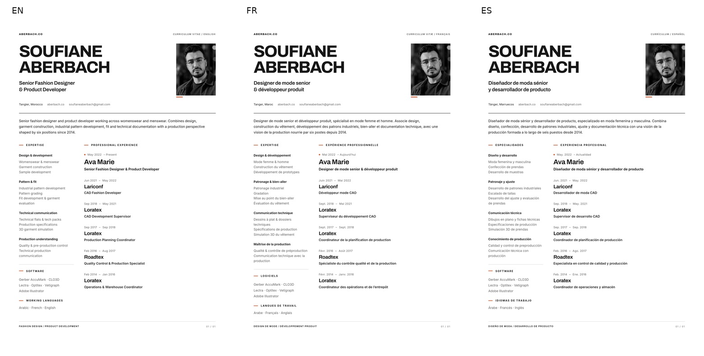

# Multilingual reconciliation and premium CV release

[PR #58](https://github.com/soufianeaberbach-sudo/portfolio/pull/58) ·
`feat/en-fr-es-reconciliation-cv` · base main
`6a487817cd4a585c5140547aa9b74e2b8c6dac35`, rechecked remotely on 29 October.

## Recovery and implementation

The interrupted session's implementation commit `744bbc7`, all six CV exports,
editable sources, exact preservation receipts, translation matrices, screenshots
and structured QA evidence survived. Nothing was reset or regenerated. The
recovered finishing changes and inspected screenshots were committed in
`b45041d` before continuation. Temporary logs/browser installs did not survive;
unfinished verification was rerun with durable logs in ignored
`.qa-director/release-2026-10-29/`.

Current components are based on main, not PR #46. Exactly EN/FR/ES use shared
page implementations: 30 indexable localized URLs, 36 total static pages.
French and Spanish cover current copy, 188 garment records/147 shared editorial
translations, 281 unique Portfolio image descriptions, post-Claude browsing,
paired photographic zoom, provenance, all five Tech Packs, image-reader errors,
Contact validation, informational pages and metadata. Arabic routes, switcher,
dictionaries, font/RTL code and SEO are absent. Actual spoken Arabic remains.

The [page matrix](PAGES-RECONCILIATION.md) and
[Portfolio matrix](../i18n-reconciliation/PORTFOLIO.md) record source differences.
The [maintenance guide](../../LOCALIZATION.md) describes architecture and edits.

## Validation completed on 29 October

| Command / suite | Final result |
| --- | --- |
| `npm ci` | 339 dependencies installed from lockfile |
| `npm run build` | 36 pages, successful |
| `npx wrangler deploy --dry-run` | Successful; existing KV/R2 bindings retained |
| `npm run test:worker` | 509 passed, 0 failed |
| `npm run test:domain` | 293 passed, 0 failed |
| `npm run test:production` | Passed, including localized negative fixtures |
| `npm run test:smoke` | 368 passed, 0 failed |
| `npm run test:i18n` | 691 passed, 0 failed |
| `npm run test:cv` | All three print/content/pixel suites passed |
| Existing photographic/content contracts | All passed |
| Strict source and evidence preservation | 7,485 checks passed; 1,733 evidence files |
| Studio foreground/background checks | 6,812 passed, 40 looks / 120 views / 40 masters |
| Technical-document and credibility verification | Five PDFs, 50 PNG pages, 50 reading copies and measurement paths passed |
| All 19 existing CI continuity scripts | 5,977 reported checks passed |

[Machine verification](release-verification.json) retains per-suite commands,
counts and durable log paths. Two early continuity attempts overlapped the
Wrangler rebuild; both passed on the stable build. Their original records and
successful retries are retained rather than erased.

The localization browser suite visits every indexable page in every language at
390, 430, 768, 1024, 1366, 1440 and 1920px. It checks language switching, immutable
Portfolio fragments, nearest-language 404, metadata, no Arabic interface,
localized validation/server refusals, exact English API stage values, geometry,
and six file types/signatures plus real PDF/PNG downloads on mobile. The
separate [18-combination Portfolio record](../i18n-reconciliation/portfolio-browser-results.json)
exercises real Front/Back loading, independent zoom/Fit, Escape and document
reading in all three languages at the six requested widths. Final provenance,
short labels and intentionally failed-page retry messages are also recorded.

No photograph, original garment data, ordering, Worker, Wrangler binding,
credential or production security setting changed. Exact localization-source
receipts extend the original strict locks and also protect sources/assets added
after the historical snapshot. Three document-foundation source exceptions are
pinned by original SHA256 and authorized Git blob; no document/image exception
was added.

## CV delivery and visual evidence

| Edition | Reviewed A4 PNG | Matching searchable A4 PDF |
| --- | --- | --- |
| English | [PNG](../../../../public/cv/Soufiane-Aberbach-CV-EN.png) | [PDF](../../../../public/cv/Soufiane-Aberbach-CV-EN.pdf) |
| Français | [PNG](../../../../public/cv/Soufiane-Aberbach-CV-FR.png) | [PDF](../../../../public/cv/Soufiane-Aberbach-CV-FR.pdf) |
| Español | [PNG](../../../../public/cv/Soufiane-Aberbach-CV-ES.png) | [PDF](../../../../public/cv/Soufiane-Aberbach-CV-ES.pdf) |

All PNGs are 2480×3508, 300 DPI, with white printer-safe edges and the same actual
portrait. All six positions, dates, tools and working languages are consistent.
The PDF image is pixel-identical to its approved PNG and fills an exact
210×297mm page; searchable source text and contact links are retained. No
education, language levels or employer achievements were invented.
[Print critique](CV-REVIEW.md) · [editable production sources](../../../../scripts/cv/README.md).

The six pushed files were fetched independently from the public branch and
matched local exports byte-for-byte: [remote verification](cv-remote-verification.json).
Browser tests additionally verified their actual website paths, Content-Type,
file signatures, descriptive filenames and same-page download behavior. Primary
Experience action chooses the current locale; compact native options expose all
six editions.

Selected inspected website captures:

- Experience: [EN 390](screenshots/pages/en-experience-390.png),
  [FR 390](screenshots/pages/fr-experience-390.png),
  [ES 390](screenshots/pages/es-experience-390.png).
- Contact: [FR 390](screenshots/pages/fr-contact-390.png),
  [ES 390](screenshots/pages/es-contact-390.png).
- Paired inspection: [EN desktop](screenshots/portfolio/en-menswear-reader-1440.png),
  [FR phone](screenshots/portfolio/fr-womenswear-reader-390.png),
  [ES phone](screenshots/portfolio/es-menswear-reader-430.png).
- Document reader: [FR desktop](screenshots/portfolio/fr-techpack-reader-1440.png),
  [ES desktop](screenshots/portfolio/es-techpack-reader-1440.png).
- Final [ES Home 390](screenshots/pages/es-home-release-390.png) has zero overflow
  after shortening the professionally edited headline without reducing type.

[Page critique and refinements](PAGES-VISUAL-QA.md) documents actual typography,
photo integration, spacing and mobile inspection. These are Chromium desktop
and touch-emulated checks; physical iPhone/Android hardware was unavailable.
The searchable PDFs are not claimed as audited PDF/UA documents.

## Remote CI and production boundary

The first remote CI run lacked the pinned main object in its shallow checkout;
an exact baseline fetch fixes that without reducing source checks. The second
run passed document verification and then exposed the October `ubuntu-latest`
migration to Ubuntu 26.04, unsupported by pinned Playwright 1.56.1. CI now uses
supported Ubuntu 24.04 with the same pinned browser and every existing test.
Current remote status and run links are maintained on PR #58.

This branch is not merged or production-deployed. Existing production remains
active. Publish by merging the reviewed PR through the existing main-branch
Cloudflare workflow, then verify its live deployment. Final public files are
`https://aberbach.co/cv/Soufiane-Aberbach-CV-{EN,FR,ES}.{pdf,png}` after that
release; the public feature-branch downloads are available now. No Cloudflare
credentials were changed and no production deploy or form submission was forced.
