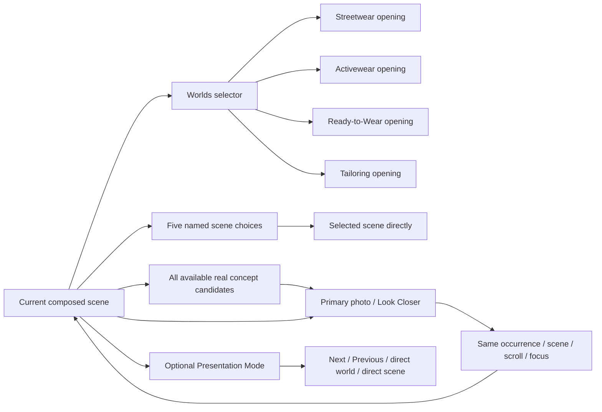

# Three levels of access / a presenter who stays in control

This is an isolated concept specification and proof. It does not replace the
existing Portfolio router or claim production history integration.

## Explore

Native local scroll drives a short 3.4-screen viewing field. It never scrolls
through skipped categories. No timer, autoplay or audio. All five named scene
buttons remain immediately available; Previous/Next are alternatives, not a
required slide sequence. Streetwear is the authored motion experiment; the
other worlds test composed visual/keynote destinations, not final scroll films.

World selection prepares that destination's small candidate cast, then installs
its opening at position zero. The old scene remains intact during decoding.
Rapid requests use a generation token; a stale destination cannot win. No
intermediate categories play. A failed source leaves the current world usable.

## Presentation

Present enters an in-page stage, stops scroll progression and holds the current
nearest composition. Fullscreen is a separate deliberate button. Its API may be
missing or rejected (notably depending on Safari/device); the in-page mode stays
available. No orientation lock or automatic fullscreen request.

While **the stage itself has focus**, supported remote keys are:

| Direction | Signals |
| --- | --- |
| Next | ArrowRight, ArrowDown, PageDown, Space |
| Previous | ArrowLeft, ArrowUp, PageUp, Shift+Space |
| First / last | Home / End |
| Exit in-page presentation | Escape, after nested inspection/dialog levels close |

Remotes differ; no claim is made about all vendors. Visible Previous/Next,
world/scene choices and Exit are the fallback. Present initially focuses the
stage. After interacting with a focused button/menu, click the stage or Tab back
to it before sending remote signals. Keyboard events on buttons, links, menus,
inputs and the reader are not captured as scene advancement.

Controls become quiet during a held presentation and reappear on pointer activity
or keyboard focus. They are not deleted from accessibility navigation. No idle
animation runs; the timeout only changes control visibility. Reduced motion uses
immediate complete frames. Mode exit restores the prior Explore place in the same
world; after an explicit world jump it restores that new world's opening.

## Reader and occurrence return

Native dialogs provide top-layer isolation and focus containment. The reader
preserves the actual clicked node, including an archive occurrence of the same
look. Opening/return from a scene measures source/target rectangles and decodes
before drawing a 540ms opaque photographic clone. No opacity mixing of bodies.
Windowed studies open the whole source directly rather than pretend their crops
register with a complete original. Keyboard/reduced motion settle immediately.

Look Closer supports bounded drag, two-finger pinch, plus/minus zoom and Fit.
With inspection focused, arrow keys pan, +/- zoom and 0 fits. Escape first exits
inspection, then closes the reader, then the underlying archive/world dialog;
a further Escape on the focused presentation stage exits Presentation Mode.
The Return button deliberately exits inspection and returns in one action.
The exact source, scroll and scene remain; resizing recomputes geometry, and an
interrupted exit settles safely rather than stranding an old clone.

All actual proof images are single-view. PRIMARY PHOTOGRAPH is honest; there
are no fake Back/Side buttons. Original Source and photographer-page links remain
available. Full future FinalViews switching requires genuine media and the next
approved reader integration phase, not neutral fake image fixtures in public.

## Public integration boundary

The dev route is `/lab/menswear/concept`; the clone-and-serve review is index.html.
The proof uses local in-memory world/scene state. It does **not** push #A–E or add
listeners to portfolio.astro, manipulate the public Portfolio hash, or replace
its history/locks/Escape handlers. Its links to current #menswear categories work
through the existing public implementation. Browser Back/Forward, permanent new
reader URLs and source focus across production layers must be integrated and
tested through that existing router after artistic approval.

No protected shared implementation change is necessary for this concept. A
future production adapter proposal must be reviewed before modifying shared
router/reader behavior, with Womenswear regressions explicitly covered.
