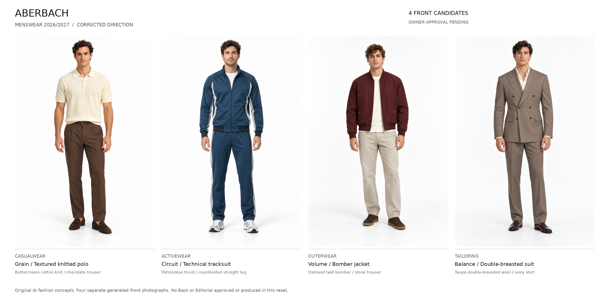

# ABERBACH — corrected Menswear direction / owner review

**Forty-look plan · four new Front candidates · owner approval pending.**

- [Standalone interactive review — download and open locally](index.html)
- [Printable review](DIRECTION-REVIEW.pdf)
- [Forty original product concepts, construction, styling and casting](COLLECTION-PLAN.md)
- [Research references and date/cache limits](RESEARCH.md)
- [Proposed taxonomy and safe route migration](TAXONOMY-AND-MIGRATION.md)
- [Previous eight pilots: product and casting assessment](PREVIOUS-PILOT-ASSESSMENT.md)
- [Truthful production registry: native paths, dimensions, SHA256 and reviews](PRODUCTION.json)
- [Focused QC and preservation](evidence/QUALITY-AND-PRESERVATION.json)
- [Browser checks](evidence/BROWSER-RESULTS.json) and [visible critique](evidence/VISUAL-REVIEW.md)
- [Remote verification receipts](receipts)

The four new Fronts are Grain (textured polo), Circuit (technical tracksuit), Volume (bomber) and Balance (double-breasted suit). They are review candidates, not artistically accepted garments. Each is a separate text-only generation with no historical or retail image input. Natural young-adult casting replaces forced appearance differentiation.

Native images are 1024 × 1536 and retained byte for byte. Each 1800 × 2700 export is uniformly resampled, not native high-resolution photography. The comparison board and review previews do not create extra selected photographs. No Back, Editorial or master has been generated in this corrected phase.

## Remaining work and explicit gate

The target remains exactly 40 approved looks and 120 active photographs. Current corrected production: **4 Front candidates; 0 owner-approved active images; 116 views unproduced** (36 remaining Fronts and all 40 Back + 40 Editorial). No corrected master is complete. Archived earlier pilot images are excluded from these counts until any explicit selection decision.

Owner review is required for taxonomy, collection plan and these four Fronts. After explicit approval, lock visible construction and styling, produce genuine companions and the remaining approved looks, verify continuity and Editorial quality, assemble forty masters, save and remotely verify every accepted production result, then implement and test the approved mapping. Final integration and a reviewable collection PR remain future work.

All historical assets and the previous eight generated sets remain unchanged. No public navigation, featured edit, viewer or Womenswear code is changed. No merge or deployment.
