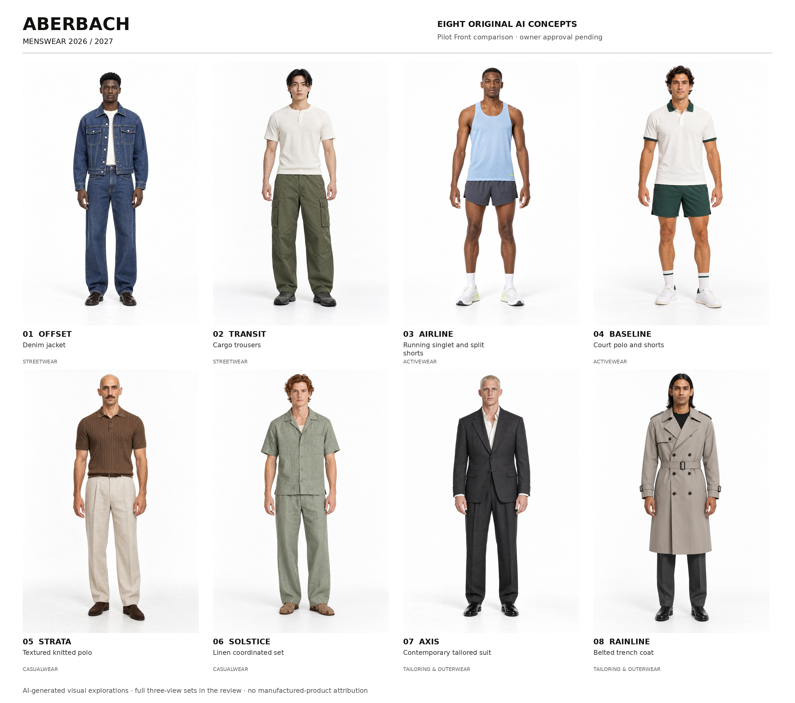

# ABERBACH — original Menswear / pilot review

**Eight pilot looks · 24 selected photographs · eight masters · owner artistic approval pending.**

The forty-look collection is planned. Generation stops at these eight pilots under the owner's Phase D gate. The public collection, historical routes, credits, Menswear viewer and Womenswear remain unchanged. This branch is not merged or deployed.

- [Portable interactive review — download and open locally](index.html)
- [Printable review PDF](PILOT-REVIEW.pdf)
- [Forty-look merchandising and casting plan](COLLECTION-PLAN.md)
- [Verified structure and product taxonomy](TAXONOMY.md)
- [Detailed concepts and construction](COLLECTION-PLAN.json)
- [Dated retail research and limitations](RESEARCH.json)
- [Production registry, selected files, SHA256 and per-image reviews](PRODUCTION.json)
- [Asset and historical-source preservation audit](ASSET-AND-PRESERVATION-AUDIT.json)
- [Six-size browser checks](evidence/BROWSER-RESULTS.json) and [visible critique](evidence/VISUAL-REVIEW.md)
- [Remaining thirty-two looks and next production phase](REMAINING-WORK.md)

## The pilot edit

| Category / slot | Concept | Primary product | Three-view master |
| --- | --- | --- | --- |
| Streetwear / 03 | Offset | Denim jacket | [Front / Back / Editorial](../../../../public/portfolio/ai-concepts/menswear-2026-2027/mw26-streetwear-03/master.png) |
| Streetwear / 05 | Transit | Cargo trousers | [Front / Back / Editorial](../../../../public/portfolio/ai-concepts/menswear-2026-2027/mw26-streetwear-05/master.png) |
| Activewear / 02 | Airline | Running singlet and split shorts | [Front / Back / Editorial](../../../../public/portfolio/ai-concepts/menswear-2026-2027/mw26-activewear-02/master.png) |
| Activewear / 04 | Baseline | Court polo and shorts | [Front / Back / Editorial](../../../../public/portfolio/ai-concepts/menswear-2026-2027/mw26-activewear-04/master.png) |
| Casualwear / 02 | Strata | Textured knitted polo | [Front / Back / Editorial](../../../../public/portfolio/ai-concepts/menswear-2026-2027/mw26-rtw-02/master.png) |
| Casualwear / 05 | Solstice | Linen coordinated set | [Front / Back / Editorial](../../../../public/portfolio/ai-concepts/menswear-2026-2027/mw26-rtw-05/master.png) |
| Tailoring / 01 | Axis | Contemporary tailored suit | [Front / Back / Editorial](../../../../public/portfolio/ai-concepts/menswear-2026-2027/mw26-tailoring-01/master.png) |
| Outerwear / 04 | Rainline | Belted trench coat | [Front / Back / Editorial](../../../../public/portfolio/ai-concepts/menswear-2026-2027/mw26-tailoring-04/master.png) |

## Construction and casting review

All selected Fronts passed an agent visual review before companion production. Each companion uses only its accepted new Front as an image reference. No historical Menswear photograph was viewed or supplied to generation. Retail product/category text informed commercial planning; retail images and logos were not generation inputs.

The denim set shows a rear yoke, vertical panels and hem adjusters. Cargo shows rear flaps, side bellows and articulated knees. Running uses a genuine racerback and rear zipped storage, while court uses polo binding, side vents and a lateral recovery pose. Linen shows a real rear box pleat. Tailoring shows a centre-back seam and twin vents. The trench shows a rear storm shield, waist belt, cuff straps and centre pleat/vent.

Two Front attempts were rejected and retained separately: the initial knit model resembled the court casting; the initial suit had similar casting and too much waist suppression/taper. Selected casting uses a shaved head/moustache for Strata and a platinum buzz cut for Axis.

Accepted visible refinements are documented: Strata has a four-button placket and light tuck; Rainline is below knee with an eight-button arrangement; Solstice's fisherman shoes have small toe windows. The trench Editorial hand partly overlaps the storm flap; the Front shows it clearly. Proposed technical notes are visual design intent, not physical fit, manufacturing, textile or sports-performance evidence.

## Native files and export truth

Each selected native is **1024 × 1536**, retained byte for byte with SHA256. Individual exports are **1800 × 2700**; masters are **5400 × 2700**, ordered Front / Back / Editorial. These are uniformly resampled exports, not native high-resolution detail. No stretching, anatomy edits, background removal or garment retouching was used. Four responsive master widths and individual 600-pixel WebP previews are saved for every pilot.

Each selected image and completed set was committed and pushed. Remote bytes were downloaded from immutable commit URLs and checked; [receipts](receipts) record those checks. Two overlapping pushes during recovery were corrected and the affected commits remotely reverified. The production utility now locks registry mutations and verifies immutable committed bytes.

## Owner decision

Review the actual garments, silhouettes, fabrics, colours, casting, hair, footwear, studio and Editorial gestures. Approve the pilot direction or identify changes by concept name. The remaining 32 looks and 96 photographs are unproduced. Public integration, a final collection Pull Request, merge and deployment have not been performed.
